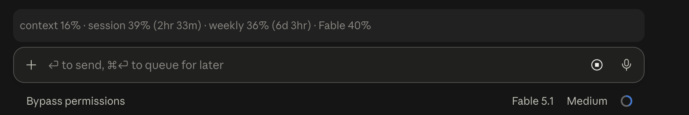

# context-band

A Claude Code mod that keeps one dim line above the prompt:



Out of the box it shows:

- `Context`: how full the session's context window is
- `Session` / `Weekly`: the plan's 5-hour and 7-day rate-limit windows, each with the time until it resets, like `Session 39% (2hr 33m)`
- one entry per model-scoped weekly window the account has (`Fable` here)

The figures refresh after every turn. With an API key, Bedrock, Vertex or a gateway there are no plan windows, and the line shows `Context` alone.

## Install

Either way the mod is installed at user scope and loads in every later session, including the ones Claude Code Desktop starts.

1. In a terminal session of Claude Code (the command is not available inside a Desktop session):

   ```
   /plugin install context-band --marketplace JiahaoXu10Arthur/context-band
   ```

   Answer `y` to add the marketplace, pick the user scope, then choose which parts of the line to show (the defaults are fine; everything can be changed later).

2. Or paste this repo's link into any Claude Code session, Desktop included, and ask Claude to install it. It runs:

   ```
   claude plugin marketplace add JiahaoXu10Arthur/context-band
   claude plugin install context-band@jiahaoxu-mods
   ```

## Choosing what the line shows

Every part of the line is a switch. Open `/config` and look for the rows under `context-band`; a change takes effect at once. The parts, in the order they are drawn:

| Switch | Shows | Default |
| --- | --- | --- |
| Model name | the session's model, as `/model` shows it | off |
| Working folder | the name of the working directory | off |
| Git branch | the checked-out branch, `folder (branch)` when both are on | off |
| Context window fill | `Context 27%` | on |
| Context tokens | `(54k/200k)` after the context percentage | off |
| 5-hour window | `Session 25%` | on |
| 7-day window | `Weekly 33%` | on |
| Reset countdowns | `(2hr 15m)` after each window | on |
| Per-model windows | `Fable 36%`, one per model-scoped window | on |
| Session cost | `$1.23`, as `/cost` totals it | off |
| Turn count | `12 turns` | off |
| Session duration | `Elapsed 1hr 15m`, refreshed every minute | off |
| Clock | `22:30`, refreshed every minute | off |

With every switch off the mod draws nothing. The switches are stored in `~/.claude/settings.json` under `pluginConfigs`, so they can be edited there too.

## Caveats

- Mods use the plugin hooks API, which is early access and may change between Claude Code releases.
- Per-model windows come from `api.anthropic.com/api/oauth/usage`, an endpoint Claude Code uses internally and does not document. The mod calls it with the session's own credential through `$.session.authorize()` and never sees the token. If the endpoint changes, the per-model entry disappears and the rest of the line keeps working. With the per-model switch off the endpoint is not called at all.

## Develop

```
claude plugin validate .
claude plugin test .
```
